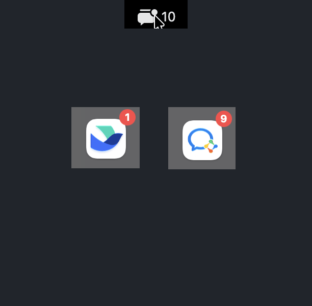
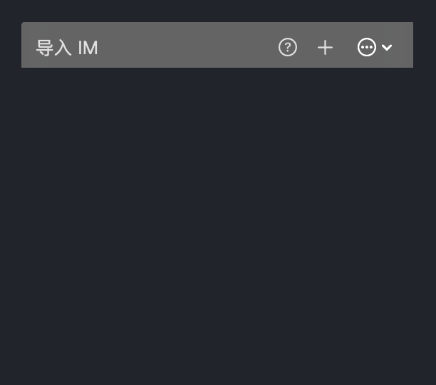
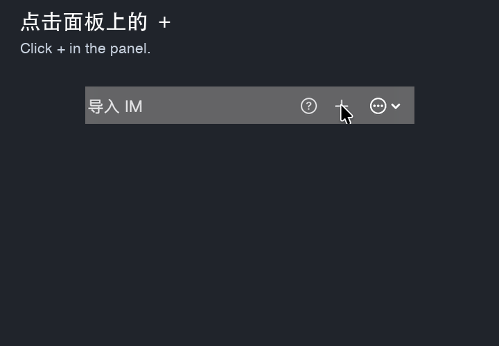
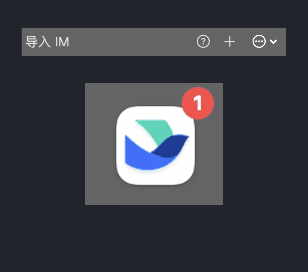
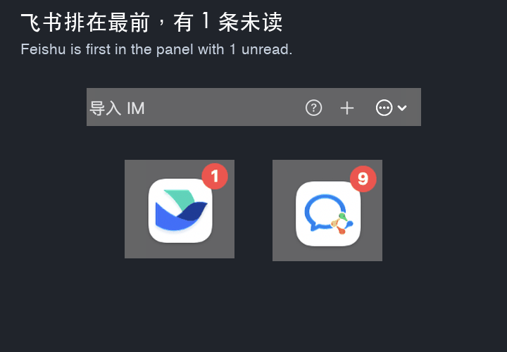

# Mac-imbox

See the combined unread count for your messaging apps in the Mac menu bar. Click to choose an app, or right-click to open the first one with unread messages.

**[Download Mac-imbox v1.14](https://github.com/uniquechao/Mac-imbox/releases/download/v1.14/Mac-imbox-1.14-universal.dmg)** · [中文指南](README.md) · [All releases](https://github.com/uniquechao/Mac-imbox/releases)

For macOS 14 or later on Apple silicon and Intel Macs.

## Get started

1. **Install Mac-imbox.** Open the downloaded DMG, drag **消息板** to Applications, and launch it from there.
2. **Add your messaging apps.** Click the Mac-imbox menu bar icon. Choose **导入 IM** to import installed apps such as WeChat, WeCom, Feishu, and DingTalk. Use **＋** to pick apps yourself.
3. **Show unread counts.** If you see **无法读取未读数**, click **打开权限设置** and grant Accessibility access to **消息板**. Individual badges and the menu bar total refresh in about three seconds.

Click **?** in the panel to revisit the built-in guide.

Watch the built-in guide

### Add an app manually

Click **＋**, select an app in **Applications**, and click **Open**. In this example, Clash Party appears in the last row when the panel reopens.

## Everyday shortcuts

| To… | Do this |
| --- | --- |
| See which apps have unread messages | Click the Mac-imbox menu bar icon. Click outside the panel to close it. |
| Jump straight to unread messages | Right-click the menu bar icon. The first app in panel order with a numeric badge opens. If no count is available, the panel opens. |
| Open a particular app | Click its icon inside the panel. Apps disappear when they quit and return the next time they launch. |
| Find shortcuts for an app | Right-click its icon inside the panel. Available commands depend on the app. |
| Restore an app’s original menu bar icon | Hold its icon in the panel until it jiggles, then click **×**. Click **✓** to finish editing. |

Watch how to edit the panel

### Open the first app with unread messages

Feishu has **1** unread and WeCom has **9**. Right-click the Mac-imbox menu bar icon showing **10**. Feishu comes to the foreground because it appears first in the panel.

## Installation and badge help

How do I restore unread counts after updating?

1. Quit the old version from **… → 退出消息板**, replace it in Applications, and launch the new copy.
2. If counts are still unavailable, open **System Settings → Privacy &amp; Security → Accessibility**. The permission name varies by macOS version.
3. Remove the old entry, then use **＋** to add and enable <code>/Applications/消息板.app</code>. Allow about three seconds for badges to refresh.

Why is one app’s badge blank?

Check the app’s own Dock icon first. Mac-imbox reads numbers exposed through the Dock or an accessible menu bar item. Apps that only flash their icon or show unread counts inside a chat window may leave the panel badge blank.

To enable an app’s Dock badge, check **Allow notifications** and **Badge application icon** under **System Settings → Notifications → the app**.

Why does macOS say it cannot verify the developer?

Version 1.14 is ad-hoc signed and has not been notarized by Apple. The [release page](https://github.com/uniquechao/Mac-imbox/releases/tag/v1.14) includes the DMG and its SHA-256 checksum.

