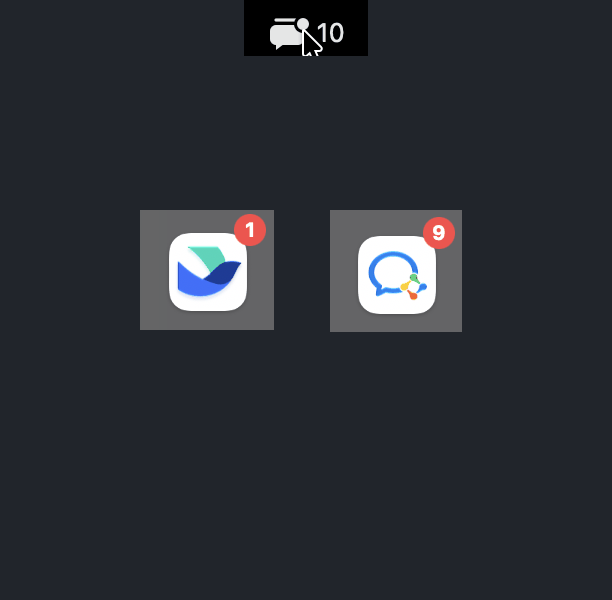
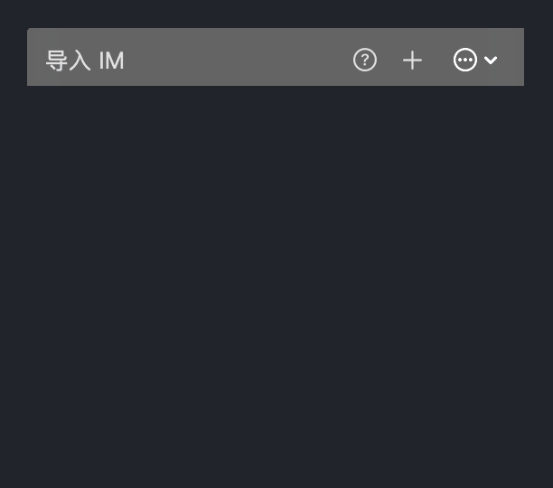
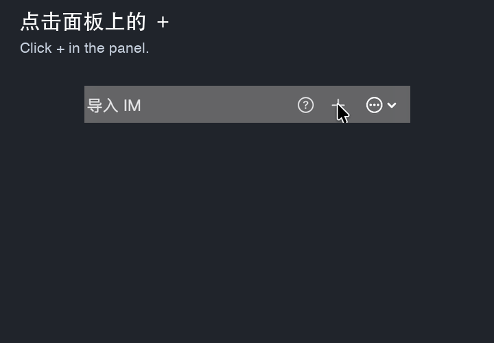
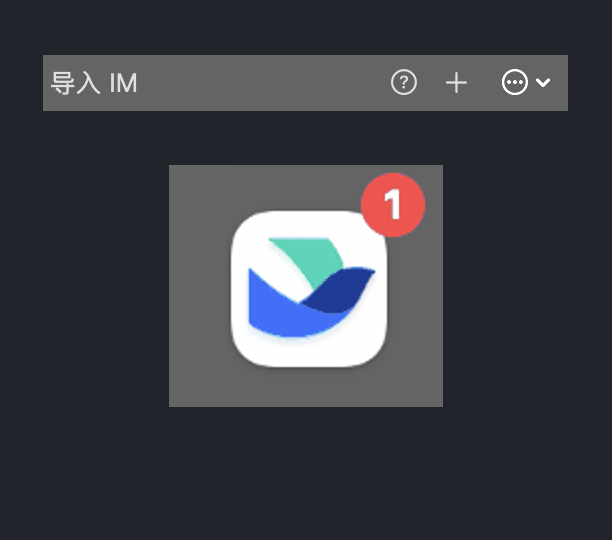
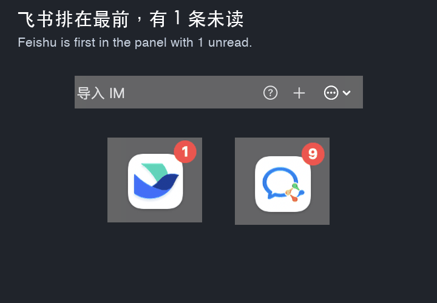

# Mac-imbox 消息板

在 Mac 菜单栏看一眼，就知道几个聊天应用一共有多少条未读。左键展开选应用，右键直接打开第一个有未读的应用。

**[下载 Mac-imbox v1.14](https://github.com/uniquechao/Mac-imbox/releases/download/v1.14/Mac-imbox-1.14-universal.dmg)** · [English guide](README.en.md) · [所有版本](https://github.com/uniquechao/Mac-imbox/releases)

适用于 macOS 14 及以上，支持 Apple 芯片和 Intel Mac。

## 第一次使用

1. **安装消息板**　打开下载的 DMG，把「消息板」拖进「应用程序」，再从那里启动。
2. **加入聊天应用**　点击菜单栏的消息板图标，选「导入 IM」一次加入已安装的微信、企业微信、飞书、钉钉等应用。想自己选，就点 **＋**。
3. **显示未读数**　如果看到「无法读取未读数」，点「打开权限设置」并允许「消息板」。约 3 秒后，面板会显示各应用的角标，菜单栏会显示总数。

点击面板上的 **？** 可以重看这三个操作提示。

观看实录 · 面板里的三步指引

### 手动加入一个应用

点 **＋**，在「应用程序」中选中目标，再点 **打开（Open）**。下面用 Clash Party 演示，最后一行就是刚加入的图标。

## 平时怎么用

| 我想… | 怎么做 |
| --- | --- |
| 看哪些应用有未读 | 左键点菜单栏的消息板图标。点面板外的空白处即可收起。 |
| 直接处理未读 | 右键点菜单栏的消息板图标，打开面板中第一个有数字角标的应用。没有可读数字时会展开面板。 |
| 打开指定应用 | 在面板里左键点它的图标。应用退出后会从面板隐藏，下次启动时自动出现。 |
| 查看一个应用的快捷操作 | 在面板里右键点它的图标。菜单会在原地展开，可用命令随应用而异。 |
| 恢复应用原来的菜单栏图标 | 长按面板里的应用图标，等图标晃动后点左上角 **×**。点 **✓** 结束编辑。 |

观看实录 · 长按图标进入编辑

### 右键直达第一个未读应用

飞书有 **1** 条未读，企业微信有 **9** 条。右键点击菜单栏显示 **10** 的消息板图标，排在前面的飞书随即切到前台。

## 安装与未读角标常见问题

更新后看不到未读数，怎么恢复？

1. 从消息板的 **… → 退出消息板** 退出旧版，用新版替换「应用程序」里的旧版，再启动。
2. 若仍提示「无法读取未读数」，打开 **系统设置 → 隐私与安全性 → 辅助功能**。部分系统显示为「设备控制和数据访问」。
3. 移除旧的「消息板」授权记录，点 **＋** 添加并开启当前的 <code>/Applications/消息板.app</code>。约 3 秒后角标会自动刷新。

只有某个应用没有数字，怎么看？

先看这个应用自己的 Dock 图标。消息板能读取 Dock 或菜单栏提供的数字。如果应用只闪烁图标，或只在聊天窗口里显示未读，面板就会留空。

如果希望原应用显示 Dock 角标，可在 **系统设置 → 通知 → 对应应用** 检查「允许通知」和「标记应用程序图标」。

首次打开时，为什么 macOS 提示无法验证开发者？

v1.14 使用临时签名，未经 Apple 公证。可以在[版本页面](https://github.com/uniquechao/Mac-imbox/releases/tag/v1.14)找到安装包和 SHA-256 校验文件。

